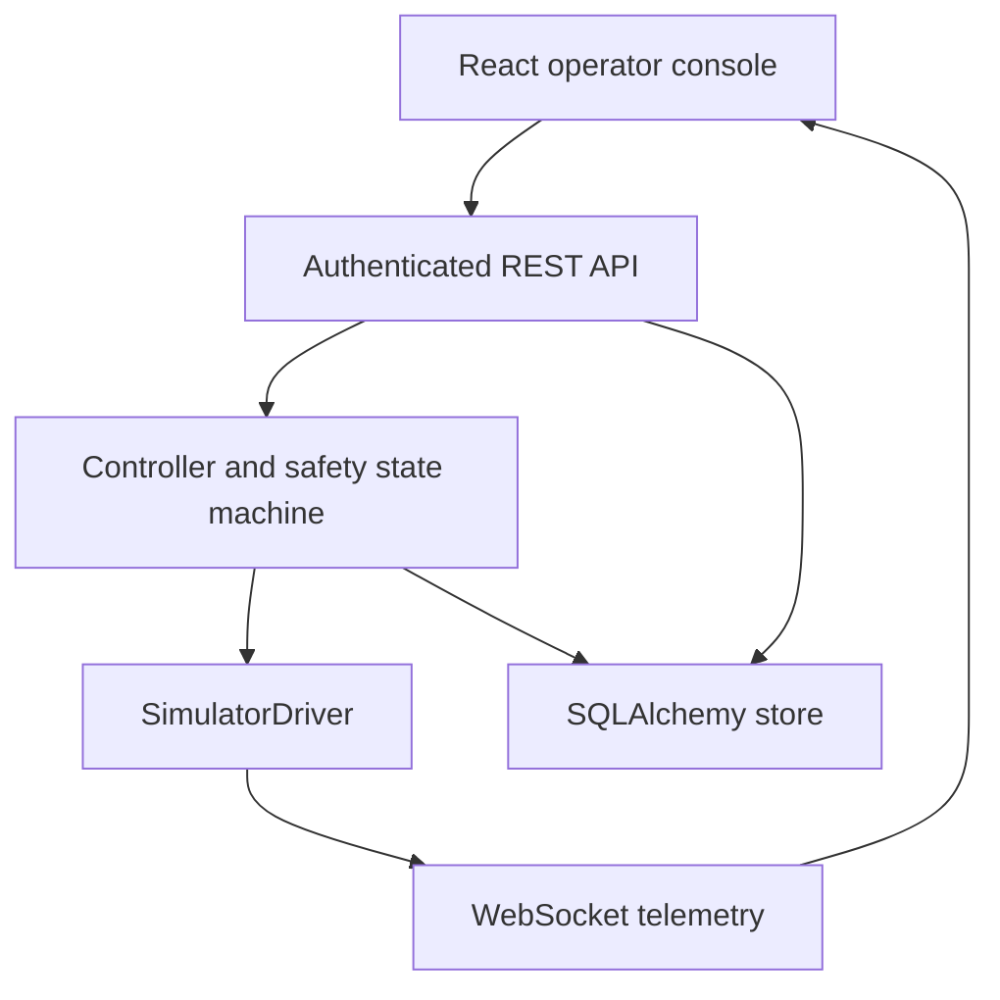

# Architecture

The backend is the authoritative state owner. The React map, controls and camera canvas never
advance the vehicle state. Controller ticks at 20 Hz; WebSocket snapshots at 5 Hz; history at 1 Hz.
The SQLite/PostgreSQL store retains missions, settings, users, audit events and sampled telemetry.
`documents(key,data)` stores version-one JSON documents keyed by type/ID. `events` and
`telemetry` have indexed timestamps. SQLAlchemy creates the initial schema. There are no
migration revisions yet; introduce Alembic before changing a deployed schema.

Manual mode accepts signed-in control-owner input with bounded speed/angular velocity,
monotonic per-lease sequence values, wall-clock freshness and a monotonic timeout.
Velocity ramps obey the configured acceleration; hard safety stops bypass the ramp.
All motion uses the same geofence, fault, battery and control-lease checks. An expired manual
command zeros velocity. A fault or lease timeout aborts active navigation and latches SAFE_STOP.
Reset requires faults to be cleared and never restores prior commands.

Mission state: READY → RUNNING ↔ PAUSED → COMPLETED or ABORTED.
RUNNING/PAUSED missions cannot be edited or deleted. Restart converts persisted active missions
to ABORTED. Waypoints have east/north coordinates and dwell seconds. The navigation law turns
proportionally toward each waypoint and reduces forward speed when misaligned or near arrival.
Return-home creates a one-waypoint mission. It does not guarantee a collision-free route.

Authentication: salted scrypt hashes, random server-side session tokens, 8-hour expiry,
HttpOnly SameSite=Strict cookie, CSRF cookie/header check for mutations, Origin check for login
and WebSocket, login throttling and 30 mutation requests/s per session. ADMIN can create accounts
and edit safety settings; OPERATOR can control/edit missions; VIEWER can only monitor.
Operator stop and emergency stop are available to any operator/admin even when another holds control.
Session state is not shared between processes and is invalidated on restart.

Telemetry retention defaults to 7 days; events to 90 days. Pruning runs every minute.
The in-process SQL store is intentionally synchronous for this local simulator. A high-rate,
multi-rover production implementation should separate ingestion, video, storage and robotics I/O.
